# Home Agent 使用教程

本教程以「截图 + 操作步骤」的形式，带你从登录到日常使用,完整了解 Home Agent 管理后台的每一个页面。无论你是抱着「给家里装一个会主动帮忙的管家」想法的管理员，还是家里一名普通成员，都能从这里找到对应页面的用法。

整体结构如下：顶部导航依次是「聊天」「场景与自动化」「定时任务」「提案审批」「配置」「记忆」。右上角是登录用户显示名、深浅色主题切换与「退出」；品牌「家庭管家」旁会常驻显示当前程序版本号（如 `v0.1.0`）。

## 登录

打开部署好的前端页面，首先看到登录卡片，品牌为「家庭管家」，副标题写着「主动式家庭 Agent 控制台」。

登录路径：直接访问部署地址的根路径即可。后端直连时为 `http://<服务器 IP>:8233/`；用 Nginx 托管前端时则为 `http://<服务器 IP>/`；本机开发模式为 `http://127.0.0.1:5173/`。以上任一情形下，尚未登录访问任意页面都会自动跳转到登录页 `/login`。

登录用法：

- 输入管理员或成员账号的用户名与密码。
- 点击「登录」后，成功即跳转到聊天页；失败会在表单下方给出提示。
- 登录状态保存在浏览器本地，关闭页面重开仍保持登录；点击右上角「退出」才会清除。

> 首次访问系统时，需要先在「配置」页用管理员账号完善 Home Assistant 与 LLM 的连接，才能正常对话。管理员账号由部署时的环境变量创建（见《Docker部署教程.md》）。

## 聊天

登录后默认进入「聊天」页，这是每天和家人交互的主要入口。它分为左侧的「会话列表」和右侧的「对话主区」。

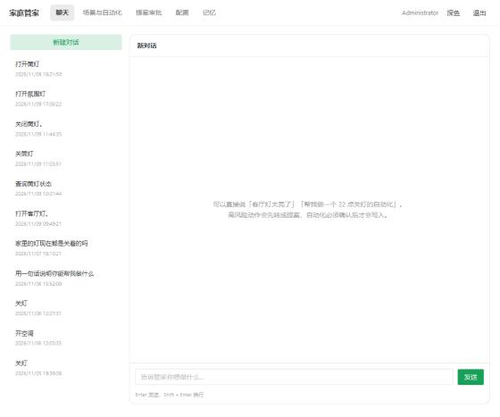

### 会话列表

- 顶部「新建对话」：点一下即开启一次全新对话，旧会话保留在下方列表。
- 每条会话显示标题（通常是第一句）与最近时间，点击即可切换到该会话的完整上下文。
- 鼠标移上可对会话做删除，删除需二次确认。

### 对话主区

在底部输入框输入你想让管家做的事，例如「打开客厅灯」。输入方式：

- `Enter` 发送，`Shift + Enter` 换行。
- 空内容时下方会显示一句示例引导，例如「可以这样问『客厅灯太亮了』『帮我做一个 22 度左右的自动空调』」。

每条回复旁会显示该次调用的路径标签：

| 标签 | 含义 | 颜色风格 |
| --- | --- | --- |
| `快路径 · Xms` | 由本地规则引擎直接命中（含情感感受词等确定性子路径），秒回，绿色 | 绿色 |
| `慢思考 · Xms` | 走了大模型深度推理 | 默认色 |
| `待澄清` | 意图不明确，向你追问细节 | 橙色警告 |
| `待确认` | 高风险动作，等你确认 | 红色 |
| `已拦截` | 被安全策略拦截 | 红色 |
| `降级` | 主模型失败改用备用模型 | 红色 |
| `超时` / `限流` | 请求超时或被限流 | 橙色警告 |
| `出错` | 处理失败 | 红色 |

当管家调用了设备工具，回复会附一个可展开的「工具调用 N 次」区块，展开可看到每次调用的工具与参数，方便你核对管家到底对哪些设备做了什么。

### 高风险动作：提案

命令涉及高风险或需要审批的动作时，管家不会直接执行，而是生成一条「提案」卡片，包含：

- 风险等级标签（`high` / `medium` / `low`）
- 目标实体（`entity_id`）
- 管家建议的动作描述
- 「去审批」按钮，点击后直接跳转到「提案审批」页处理。

### 自动化草稿

当你的命令需要「新建一个自动化」才能完成时，管家会先呈现一份可编辑的 YAML 草稿，标题为「自动化草稿（确认后才写入 HA）」。你可以：

- 直接在文本框里修改 YAML（例如调整触发时间）。
- 点「确认并写入 HA」按钮，系统按草稿写入 Home Assistant 自动化，并显示写入成功的 `automation_id` 与有效期。

> 这就是「先确认再落地」的设计：管家把想法变成草稿，你把关后真正写进家庭自动化。

## 场景与自动化

「场景与自动化」页是集中管理 HA 场景、脚本与自动化的地方，三种卡片并列：

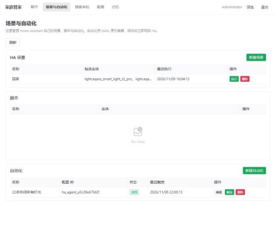

| 卡片 | 内容 | 操作 |
| --- | --- | --- |
| HA 场景 | 已保存的场景列表（名称 / 包含实体 / 最近执行） | 新建、执行、删除 |
| 脚本 | HA 脚本列表（名称 / 实体） | 执行 |
| 自动化 | HA 自动化列表（名称 / 配置 ID / 状态 / 最近触发） | 编辑、触发、删除 |

- **新建场景**弹窗中，填写场景标识，并从「快路径可语音命名的实体」里多选要包含的实体（该项数据来自语音词库/目录，未收录的实体也可手动输入 `entity_id`）。
- **自动化**以 YAML 编辑器呈现，新建模板内置了一个示例触发：`platform: time` 在 `22:00:00` 打开灯的自动化，可直接改写成自己的时间与动作。每行自动化的「状态」用标签标识启用/停用，方便一眼看出当前哪些自动化在生效。

## 提案审批

「提案审批」页是安全的关键一环，主题写着「所有设备动作都经过安全审核校验；高风险动作必须人工确认」。

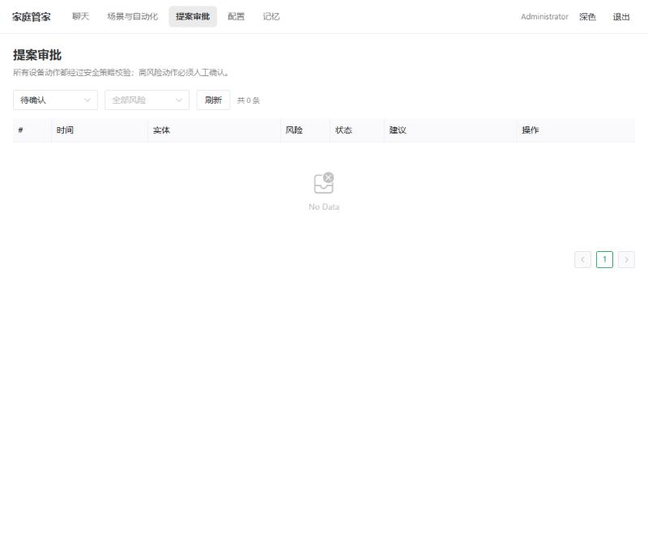

### 筛选与列表

顶部提供两个筛选器和「刷新」按钮：

- 状态筛选：待确认 / 已批准 / 执行中 / 已执行 / 失败 / 已拒绝 / 超时 / 已取消。
- 风险筛选：high / medium / low。

列表按时间倒序展示每条提案，包含 时间、实体、风险标签、状态标签、建议 等列。普通成员只能看到与自己相关的待办；管理员可看到全部。

### 处理一条提案

点击「详情」打开抽屉，可看到完整信息：

- 编号、实体、风险等级（含风险来源 `risk_source`）
- 来源、创建时间、过期时间
- 推理过程（thought）、建议（suggestion）
- 被拒时拒绝原因（reject_reason）
- 展开的动作 JSON 与执行结果 JSON

待确认的提案，操作列提供「批准执行」「拒绝」「取消」三个入口。决定后提案状态流转到「执行中 / 已批准 / 已拒绝」，并可随时在列表里回看历史。高风险的实时新增会弹出显著告警，提醒及时处理。

## 定时任务

「定时任务」页统一管理语音/对话里设置的定时指令，主题写着「查看语音/对话设置的定时指令，可提前取消；下方为定时执行记录，便于审查」。

页面分两块：

| 区块 | 作用 | 操作 |
| --- | --- | --- |
| 进行中的定时 | 尚未执行的定时指令（总结 / 类型 / 动作 / 计划执行 / 发起人 / 来源 / 状态） | 「取消」提前取消 |
| 执行记录 | 已到点执行的任务留痕（任务 / 动作 / 状态 / 执行时间 / 详情） | 只读回看 |

- **类型**表意：`相对`（如「5 分钟后」）、`绝对`（如「今晚 8 点」）、`模糊`（如「明天早上」）、`时长`。来源列对飞书渠道下发的定时会带飞书标签。
- 定时到点后状态流转到「已执行」并在执行记录中留痕，供审查每次定时动作到底对家里做了什么。

> 定时指令通常在对话中下达（例如「客厅灯 5 分钟后再关」），管家会创建一条定时任务；本页就是这些任务的统一视图，可在到点前反悔取消。

## 记忆

「记忆」页让管家记住每位家庭成员的偏好与反馈习惯，页面按成员独立维护。

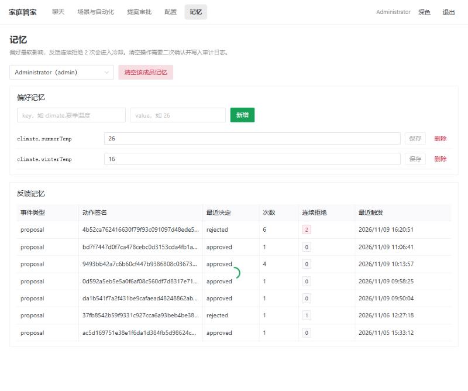

- 顶部「成员」下拉：切换查看哪一位成员的记忆（仅管理员可见）。下拉里每项以「显示名（角色）」表示。
- 「**清空该成员记忆**」：一次性清空该成员的全部记忆，操作需二次弹窗确认（仅管理员可用）。

页面主体分两块：

| 区块 | 作用 | 操作 |
| --- | --- | --- |
| 偏好记忆 | 软性偏好，影响管家的建议倾向（如 `climate.夏季温度` → `26`） | 新增键值、逐行保存、删除 |
| 反馈记忆 | 记录成员对各类动作的最近决定、次数与连续拒绝 | 只读浏览，连续拒绝 2 次进入冷却 |

偏好记忆是「软影响」——它改变管家的推荐，不强制；**来源**包括手动填写与对话中由 LLM 自动沉淀两类。每条偏好记录带 `来源`、`置信度`、`作用域` 与 `值类型`（文本 / 数字 / 布尔 / 枚举 / 范围等），便于管理。反馈记忆里**连续拒绝 2 次**的动作会自动进入冷却，管家下次会换一种建议或不再主动提。点到为止的功能保证了管家既贴心、又不烦人。

## 配置

「配置」页集中了系统的所有运行设置，以 8 个标签页呈现。只有管理员可以查看和修改，普通成员看不到此入口。点击顶部导航的「配置」即可打开。

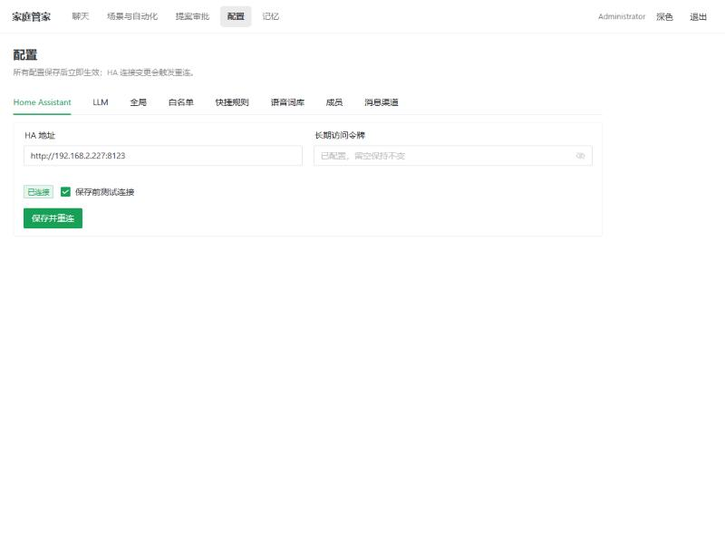

下方按标签页顺序逐一说明。所有配置「保存后立即生效」，其中 Home Assistant 连接与消息渠道的变更是通过「保存并重连」触发重连的。

### Home Assistant

第一个标签页用于连接你的 Home Assistant 实例，是整套系统的设备数据来源。

| 字段 | 说明 |
| --- | --- |
| HA 地址 | 填写 Home Assistant 的访问地址，例如 `http://homeassistant.local:8123`，生产环境通常填局域网 IP |
| 长期访问令牌 | 在「Home Assistant 个人资料 → 安全 → 长期访问令牌」页面生成后粘贴。已填过则显示「已配置，留空保持不变」 |
| 已连接 / 未连接 | 当前与 HA 的长连接状态标识 |
| 保存前测试连接 | 勾选后，保存时会先测试连通性再写入 |

填写完成后，点击「**保存并重连**」。页面上的状态标签会由「未连接」变为「已连接」，即表示对接成功。

> 令牌只用于后端与 HA 通信，不会在界面里明文回显。

### LLM

第二个标签页配置大模型，用于慢思考推理与主动推理。分为「主模型」和「备用模型」两栏。

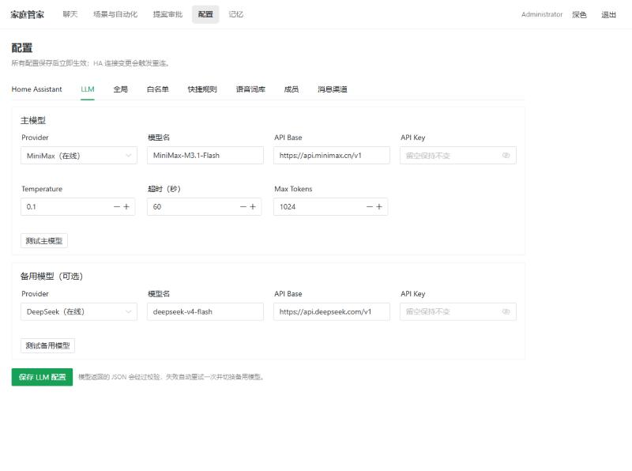

主模型字段：

| 字段 | 说明 |
| --- | --- |
| Provider | 模型供应商，内置 ollama（本地无需 Key）、deepseek（在线）、minimax（在线）等 |
| 模型名 | 例如主推的 `MiniMax-M3.1-Flash` 或 `deepseek-v4-flash` |
| API Base | 接口地址，切换 Provider 时会自动带出默认值（如 `http://api.minimax.cn/v1`） |
| API Key | 密钥，留空保持原值不变；保存时加密存储 |
| Temperature | 采样温度，范围 0–2，默认 0.1 |
| 超时（秒） | 单次请求超时，默认 60 |
| Max Tokens | 最大输出 token 数，默认 1024 |

备用模型可选。当主模型返回的 JSON 解析失败、内容校验不通过或接口异常时，会自动改走备用模型，避免一次请求直接失败。

点击「**保存 LLM 配置**」生效。建议保存后用「测试主模型 / 测试备用模型」按钮验证连通性。

### 全局

第三个标签页集中了推理调度、快路径与语音技能等运行参数。

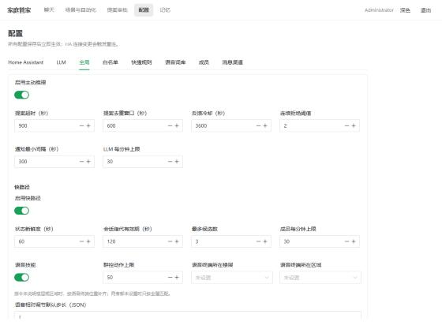

| 字段 | 说明 |
| --- | --- |
| 启用主动推理 | 总开关，关闭后系统不再主动发起推理 |
| 提案超时（秒） | 一条提案最多等待多久，超时自动过期（默认 900） |
| 提案去重窗口（秒） | 相同提案在上一次出现后多久内不再重复（默认 600） |
| 反馈冷却（秒） | 对成员反馈的上一条与下一条之间的最小间隔（默认 3600） |
| 连续拒绝阈值 | 连续被拒多少次后停止重试（默认 2） |
| 通知最小间隔（秒） | 主动推送 / 告警通知的最短频率（默认 300） |
| LLM 每分钟上限 | 慢路径对 LLM 的调用限流（默认 30） |

快路径相关字段：

| 字段 | 说明 |
| --- | --- |
| 启用快路径 | 总开关 |
| 状态新鲜度（秒） | HA 实体状态缓存多久内算新鲜（默认 60） |
| 会话指代有效期（秒） | 会话内指代关系（如「这个灯」）的有效期（默认 120） |
| 最多候选数 | 语义命中最多给出几个候选（默认 3） |
| 成员每分钟上限 | 快路径按成员限流（默认 30） |

语音技能相关字段：

| 字段 | 说明 |
| --- | --- |
| 语音技能 | 启用中文语音控制解析（默认开启，详见「语音词库」标签页） |
| 群控动作上限 | 一次群控最多操作多少个设备（默认 50） |
| 语音终端所在楼层 / 区域 | 语音终端（如装修时的控制面板）固定所在位置；指令未指明楼层或区域时按此补齐，两者都未设置则只按全屋匹配 |
| 语音相对调节默认步长（JSON） | 如 `{"brightness": 10}`，规定「调亮一点」这类相对调节的步长 |

页面底部还有三块原始 JSON 配置：

- `debounce_seconds`：按实体/域去抖，防止连续高频指令重复下发。
- `storm_limit`：风暴抑制，例如家庭里大量设备同时上报时限制动作。
- `retention`：数据保留策略，如历史版本、消息、统计的保留时长。

这些 JSON 采用「键值 + 数字」形式，按需填写即可，留空使用默认策略。

### 白名单

第四个标签页用通配符规则控制「哪些实体 / 服务 / 参数」对系统可见和可用。

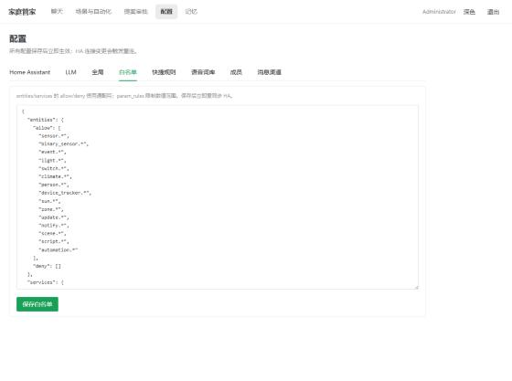

- `entities` 的 allow / deny：控制哪些实体可被查询与控制，使用通配符，如 `light.*`。
- `services` 的 allow / deny：控制哪些 HA 服务可以被调用。
- `param_rules`：限制参数的数值范围（如 `brightness` 不得超过 100）。

> 白名单是安全下线的重要一环。保存后系统会立即重同步 HA。普通成员的可见范围由「成员 → 设备权限」进一步收紧，两者叠加生效。

### 快捷规则

第五个标签页提供最快路径的控制能力：无需经过大模型，一句触发词即可命中一组动作，延迟最低。

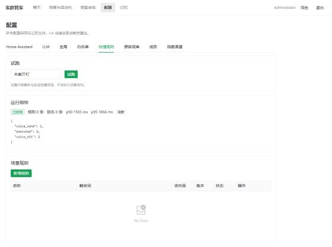

该页包含四块：

- **试跑**：输入一句话（如「关客厅灯」），点「试跑」，只做解析与安全检查预览，不会真正执行设备动作。
- **运行指标**：显示规则/别名加载数、p50/p95 延迟及计数器。
- **场景规则**：一张触发词 → 动作的规则表。新增规则时填写：
  - 名称与触发词（每行一个，逗号分隔亦可）
  - 动作：JSON 数组，例如
    ```json
    [{"domain": "light", "service": "turn_on", "target": {"type": "domain_all", "domain": "light"}}]
    ```
  - 回复模板（可选，支持 `{count}` 占位，如「已执行回家模式。」）
  - 优先级（数值越大越靠前）与启用开关
- **实体别名**：为实体定义口语别名（如把 `light.living_ceiling` 命名为「客厅主灯」），使触发词匹配更自然。别名可独立设置是否允许控制。

### 语音词库

第六个标签页是中文语音控制的核心，维护「自然说法 → 设备功能」的映射，是快路径语音技能的数据来源。

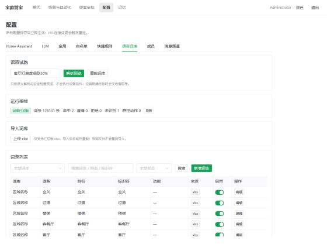

页面包含：

- **语音试跑**：输入口语句子（如「客厅灯亮度调到50%」或「客厅空调温度调高2度」），点「解析预览」，查看语义解析结果与安全检查，不会真实执行；没有明确目标时会交给慢思考。
- **运行指标**：词库是否加载、词条数，以及命中 / 澄清 / 拒绝 / 未识别 / 群控动作等计数器。
- **导入词库**：支持上传汇总版 `.xlsx` 词表，导入后自动热重载，同一文件不会重复导入。页面右上角提供「**下载模板**」，导出的 xlsx 与解析器列结构一致，可直接按列填写后上传；仓库克隆后需手动导入词库（json 种子词条不自动加载）。
- **词条列表**：按词库（楼层名称、区域名称、设备名称、场景名称、功能名称、枚举值、属性数值、单位、设备类型等）浏览和管理词条；可搜索、启停、新增/编辑/删除自定义词条。系统词条只能启停，不能改字段或删除。
- **设备能力覆盖**：为个别实体手动覆盖「功能 / 步长 / 量程」。没有覆盖的实体按 HA 属性自动推导。
- **群控设备列表**：把同一设备类型下多个实体编排成组（可按楼层 / 区域过滤），实现「全屋灯光调到 50%」这类批量控制；同一设备类型命中多个列表时，按区域、楼层、全屋的顺序取最具体的一个，列表内设备仍受可见性与可控性约束。

### 成员

第七个标签页管理家庭成员账号与权限。

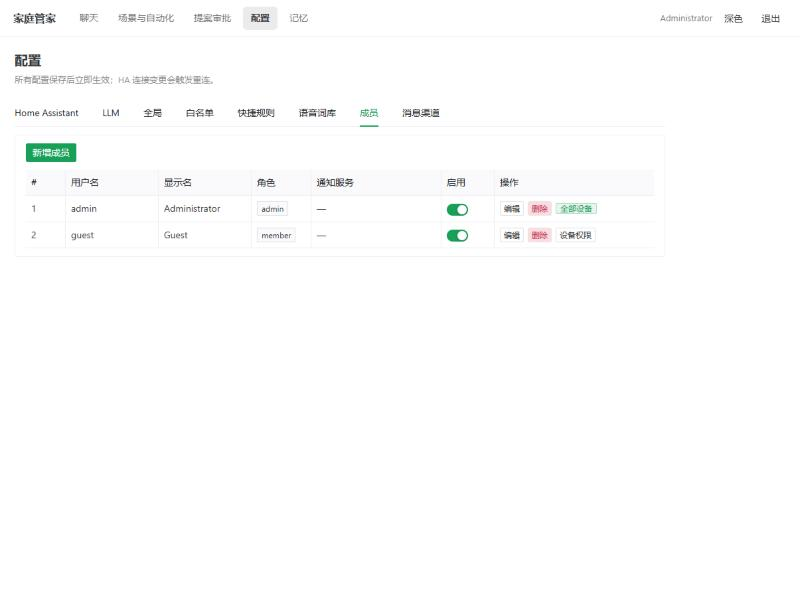

| 字段 | 说明 |
| --- | --- |
| 用户名 / 密码 | 登录凭证，密码至少 8 位，新建后可不重复填 |
| 显示名 | 在对话与界面中的展示名称 |
| 角色 | `member`（成员）或 `admin`（管理员）。管理员拥有全部设备查看与控制权 |
| 通知服务 | HA 通知服务，如 `notify.mobile_app_xxx`，用于主动告警推送 |
| 启用 | 停用的账号无法登录 |

管理员可以随时删除任一成员——在成员列表的操作列点「**删除**」，确认后该账号连同其设备权限一并移除。

对普通成员，点击行内「**设备权限**」进行细粒度授权。普通成员默认看不到任何设备、控制任何设备，必须在授权表里显式放行：

- 用通配符匹配实体，如 `*` 表示全部、`light.*` 表示所有灯。
- 每行可分别勾选「可查看」与「可控制」。
- 提供「全部设备可查看」「全部设备可控制」「所有灯可控」等快捷预置按钮。

> 权限只会对已收录到「快捷规则 / 语音词库」的可控设备进行下拉提示；其它设备可直接手动输入 `entity_id`。

### 消息渠道

第八个标签页接入飞书等消息渠道，让家庭成员通过聊天直接向 Home Agent 下发指令，并接收主动推送。

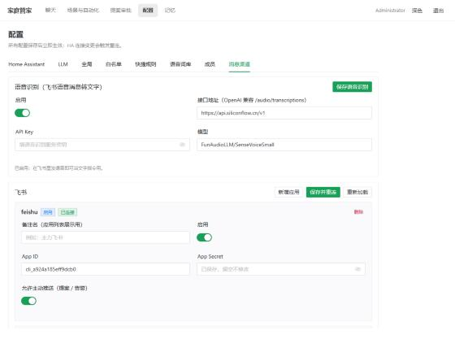

#### 语音识别（飞书语音消息转文字）

启用后，家庭成员在飞书里发送语音，系统会自动转成文字指令处理；未启用时收到语音会提示「仅支持文字」。

- **接口地址**：OpenAI 风格的转写接口，兼容 SiliconFlow、Groq、阿里云百炼等，路径为 `/audio/transcriptions`。
- **API Key / 模型**：转写服务密钥与模型名（如 `FunAudioLLM/SenseVoiceSmall`）。密钥加密保存，留空不修改。

#### 飞书

使用飞书「自建应用」的长连接（WebSocket）方式接收事件，**无需公网 IP**。

接入步骤：

1. 在飞书开发者后台创建自建应用，开启「长连接接收事件」并发布版本；确保应用已开通 `im:message.p2p_msg:readonly` 与 `im:message:send_as_bot` 权限。
2. 回到后台「消息渠道」，点「**新增应用**」，填入：
   - 备注名（应用列表展示用）
   - App ID（形如 `cli_xxxxxx`）
   - App Secret（密钥加密保存，留空不修改）
   - 是否启用、是否允许主动推送（提案 / 告警）
3. 保存后点「**保存并重连**」，状态标签将显示「连接中 → 已连接」或异常原因。
4. 先在飞书里给自己的机器人发一条消息，账号会自动出现在「**待绑定账号**」列表。

支持同时接入多个飞书应用实例；每行一个自建应用，删除或新增不会让已绑定的账号错位。

#### 账号绑定

渠道账号（如飞书 open_id）必须绑定到某个成员，才能通过该渠道下发指令。在「待绑定账号」里点「绑定」，选一位成员即可，无需手抄 open_id。绑定后，该账号的权限、风控与审计沿用成员本身的设置。

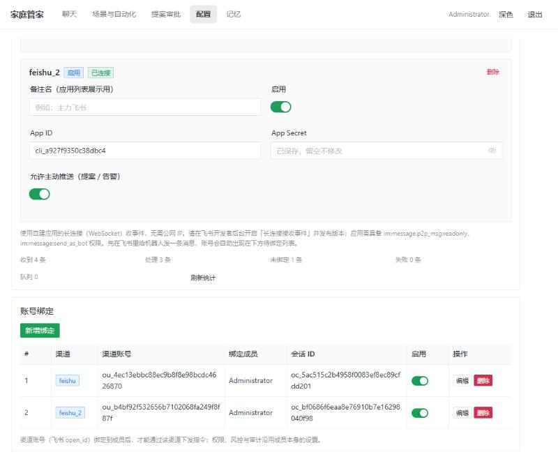

> 常见排查：若账号发来消息却收不到回复，多半是还没有在「待绑定账号」中绑定成员。

---

至此，管理后台的全部页面：登录、聊天、场景与自动化、定时任务、提案审批、记忆，以及配置的 8 个标签页，都说明完了。

建议使用顺序：先接 Home Assistant，再配 LLM，后按需启用快路径、语音技能、成员与消息渠道；随后即可在聊天页尝试对家里下达第一句指令。

部署与启动流程见《Docker部署教程.md》，备份、日志与健康检查见《部署与运维.md》。